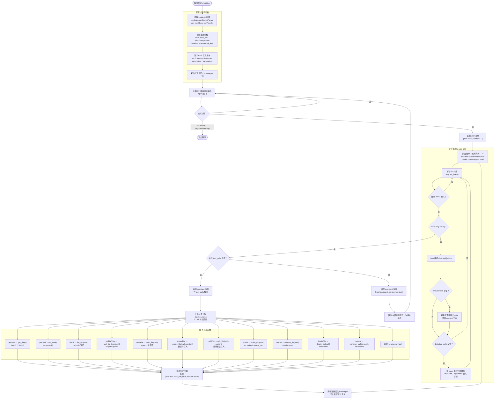

# Practice02 — 带 11 个 function call 工具的流式 LLM 命令行助手

## 一、程序功能简介

`chat03.py` 是一个基于 OpenAI 兼容 Chat Completions 接口（SSE 流式输出）的命令行 AI 助手，具备对本机文件系统的读写与增删改查能力。

核心流程：

1. **读取配置**：使用 `configparser` 从同目录的 `config.ini` 读取 `[llm]` 段的 `api_key`、`base_url`、`model`，拼接出 `{base_url}/chat/completions` 请求地址与 `Bearer` 认证头。
2. **声明工具**：以 JSON Schema 形式定义 11 个 `function` 工具（name / description / parameters），随每次请求一起发送给模型。
3. **主循环接收用户输入**：`input("我: ")` 读取一行输入，空行跳过，`EOFError` / `KeyboardInterrupt` 退出；输入写入 `messages`（`role=user`）。
4. **流式请求 LLM**：`requests.post(..., stream=True)`，`stream=True` 让模型边生成边返回。
5. **解析 SSE 流**：逐行读取 `resp.iter_lines()`，只处理 `data:` 前缀的行，遇到 `[DONE]` 结束；`delta.content` 触发"打字机"式逐字打印并累积为最终文本；`delta.tool_calls` 按 `index` 累积工具槽位（`id` / `name` / `arguments` 分片拼接）。
6. **工具分发**：本轮若无工具调用，写入 `role=assistant` 消息并结束本轮；若有工具调用，先写入带 `tool_calls` 的 assistant 消息，再按 `function.name` 用 `if/elif` 分派到对应 Python 函数，并 `json.loads` 解析参数。
7. **消息历史回填**：每个工具结果以 `{"role":"tool","tool_call_id":...,"content":...}` 追加进 `messages`，然后带着更新后的完整历史再次请求模型，直到模型不再要求调用工具为止（单轮内可多次工具调用）。
8. **全程上下文保留**：`messages` 列表是唯一的会话状态，所有 user / assistant / tool 消息都留在其中，因此支持多轮连续对话与上下文引用。

安全性提示：本程序直接执行文件系统操作（含删除目录、删除文件、覆盖写入），请仅在受控目录内使用。

## 二、11 个 function call 工具列表

| # | 工具名（function name） | 对应 Python 函数 | 参数 | 说明 |
|---|---|---|---|---|
| 1 | `getDate` | `get_date()` | 无 | 调用本机 `date /t` 与 `time /t` 命令获取当前日期时间 |
| 2 | `getCwd` | `get_cwd()` | 无 | 返回当前工作目录 `os.getcwd()` |
| 3 | `listDir` | `list_dir(path=".")` | `path`（可选，默认 `.`） | 列出目录下的文件与子目录，并标注"文件/目录" |
| 4 | `getFileType` | `get_file_type(path)` | `path`（必填） | 返回扩展名；目录返回"目录"，无扩展名返回"(无扩展名)" |
| 5 | `readFile` | `read_file(path)` | `path`（必填） | UTF-8 读取纯文本文件全部内容 |
| 6 | `createFile` | `create_file(path, content="")` | `path`（必填）、`content`（可选） | 新建文件，可带初始内容 |
| 7 | `editFile` | `edit_file(path, content)` | `path`、`content`（均必填） | 以新内容整体覆盖写入文件 |
| 8 | `mkdir` | `make_dir(path)` | `path`（必填） | 新建目录，支持多级（`os.makedirs(exist_ok=True)`） |
| 9 | `rmtree` | `remove_dir(path)` | `path`（必填） | 删除目录，允许非空（`shutil.rmtree`） |
| 10 | `deleteFile` | `delete_file(path)` | `path`（必填） | 删除单个文件（`os.remove`） |
| 11 | `rename` | `rename_path(src, dst)` | `src`、`dst`（均必填） | 重命名文件或目录（`os.rename`） |

> 说明：除上述 11 个工具外，分发逻辑还有兜底分支，未匹配到名称时返回 `unknown tool`。

## 三、架构图（architecture.mmd）



## 四、运行方式

1. 在同目录准备 `config.ini`：

   ```ini
   [llm]
   api_key = sk-xxxxxxxx
   base_url = https://api.example.com/v1
   model = gpt-4o-mini
   ```

2. 运行：`python chat03.py`
3. 输入自然语言指令（例如"列出当前目录的文件"、"读取 README.md"、"新建 demo.txt 写入 hello"），模型会自动触发相应工具并把结果汇总成回答。
